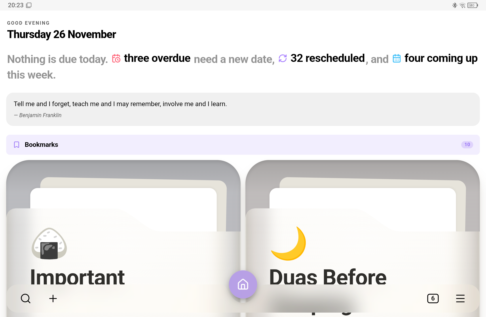
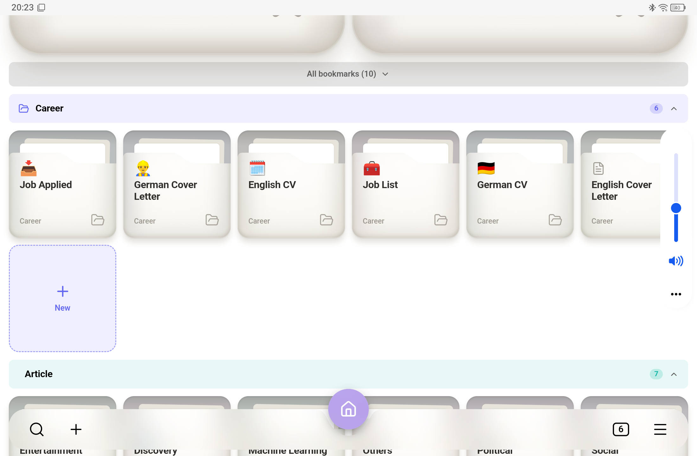
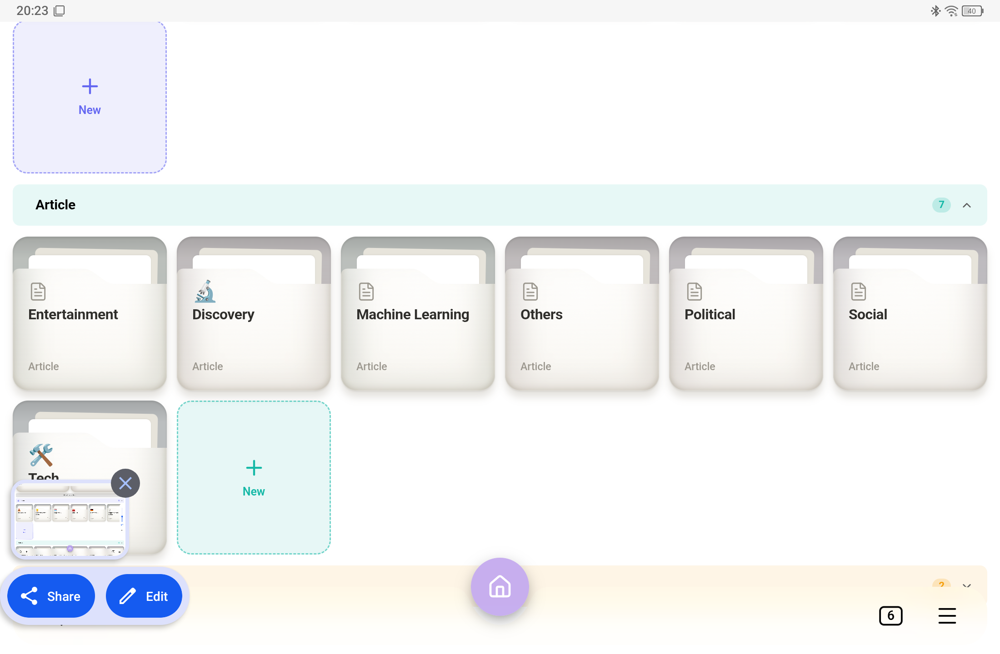
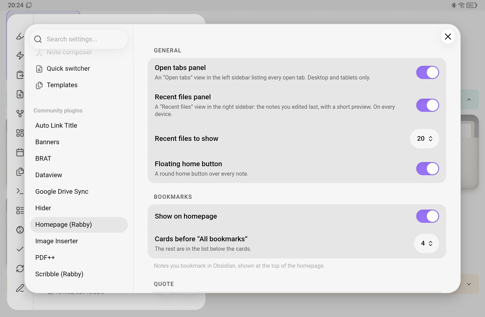
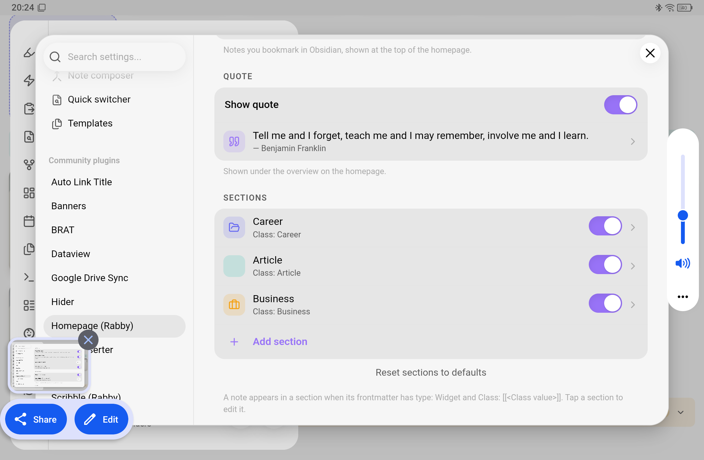
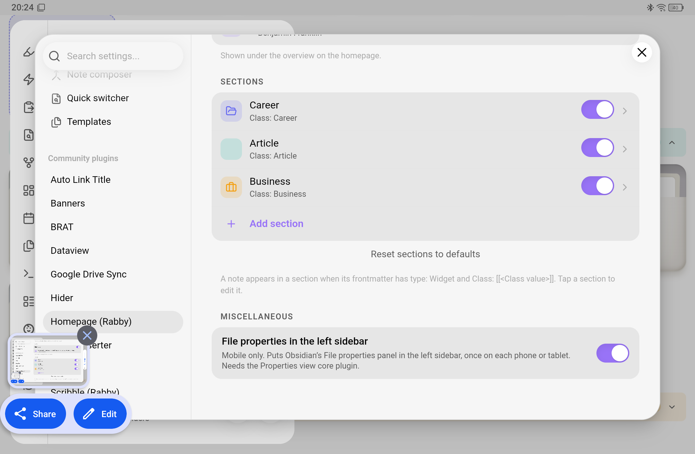

# Homepage (Rabby)

**Type:** Plugin · **Version:** 3.13.1 · **ID:** `rabby-homepage`\
**Repo:** https://github.com/rabby0101/obsidian-homepage\
**License:** All rights reserved, free to use (was MIT until 26 Nov 2026)\
**Local:** `~/projects/obsidian-homepage`\
**Works with:** [Task Manager (Rabby)](https://github.com/rabby0101/obsidian-task-manager), [Paperfold theme](https://github.com/rabby0101/obsidian-paperfold)

## Purpose
A native home screen that replaces the old Dataview-based Homepage note. It opens without a blank or jumping page, on desktop and mobile.

## What's on the homepage
From top to bottom:
1. **Greeting and date**
2. **Overview:** one sentence about tasks (due today, next time, overdue, rescheduled, coming up)
3. **Quote:** one quote you write, can be hidden
4. **Bookmarks:** cards from Obsidian's Bookmarks (notes only), then an "All bookmarks" list
5. **Sections:** collapsible card grids; the last card, **New**, creates a note in that section (in `Inbox/` if it exists)

## Screenshots
Taken on the tablet, 26 Nov 2026 (v3.13.1).

### Homepage
**Greeting, overview, quote and bookmarks**



**All bookmarks button, sections and the New card**



**Article section**



### Settings
**General and Bookmarks**



**Quote and Sections**



**Sections and Miscellaneous**



## How a note appears in a section
```yaml
type: Widget
Class: "[[Notes]]"      # must match the section's Class value
title: Optional title
banner: image link or URL
banner_icon: 📥
```
Notes can be anywhere in the vault. Newest created comes first.

## Other features
- Floating buttons on notes: back, forward, bookmark, edit/reading
- Opens notes in reading view when Obsidian's default view is Reading view
- **Open tabs** panel (left sidebar, desktop and tablet)
- **Recent files** panel (right sidebar, off by default)
- Floating home button (off by default)
- File properties in the left sidebar (mobile, off by default)

**Commands:** Home · Close other tabs · Bookmark this note · Re-cache all banners

## Settings
- **General:** Open tabs panel, Recent files panel and count (10–50), Floating home button
- **Bookmarks:** show or hide; 2, 4, 6 or 8 cards
- **Quote:** show or hide, text, author
- **Sections:** add, hide, delete, reorder; name, icon, Class value, colour; reset
- **Miscellaneous:** File properties in the left sidebar

## How it works
- Everything is in `main.js` and `styles.css`; no build step.
- Paints the last saved snapshot first, then rescans Obsidian's metadata cache.
- Remote banners are copied to `Attachments/_banners` and then read from disk.
- `data.json` holds settings; `snapshot.json` is a cache that is rebuilt on open (safe to exclude from sync).
- Which sections are open is remembered per device.

Main parts of `main.js`: `HomepageView`, `OpenTabsView`, `RecentFilesView`, `HomepagePlugin`, `HomepageSettings`, `SectionModal`, `QuoteModal`.

## Version history
- 3.13.1 (22 Nov): synced from vault
- 3.12.3 (21 Nov): Bookmarks section refreshes when bookmarks change
- 3.12.2 (12 Nov): fixed blank folder tiles on iOS
- 3.12.1 (12 Nov): deleted sections stay deleted; one generic default section
- 3.12.0 (10 Nov): File properties in the left sidebar on mobile
- 3.11.0 (9 Nov): custom dock removed; reading view follows Obsidian's setting
- 3.10.0 (9 Nov): redesigned settings, bookmark and quote settings
- 3.9.0 (9 Nov): styles ship inside the plugin

## Status (26 Nov 2026)
Vault and local clone match. Latest GitHub **release is 3.12.3**, so BRAT installs are behind.

## Known issues
From reading the code and the screenshots; not otherwise tested.
- The overview only reads `📅` and `⏰`. A task typed with `@today` that Task Manager hasn't saved yet is not counted as due.
- Leftover code from removed features (start-up takeover, custom dock) and an out-of-date "v1.0.0" header comment.
- The Article section has no icon: its Icon is set to `page`, which does not display. Pick another name, such as `file-text`.
- An unrecognised icon name leaves a blank box, with no warning visible in the section list.

## To do
- [ ] Publish a 3.13.1 release
- [ ] Make the overview read the same task shortcuts as Task Manager
- [ ] Remove leftover code

## Install with BRAT

1. Install **BRAT** from Obsidian's Community plugins and enable it.
2. Open the command palette → **BRAT: Add a beta plugin for testing**.
3. Paste `rabby0101/obsidian-homepage` and click **Add Plugin**.
4. Enable **Homepage (Rabby)** in Settings → Community plugins.

BRAT keeps the plugin updated from this repo's releases.

## Manual install

Download `main.js`, `manifest.json` and `styles.css` from the latest release into
`<your vault>/.obsidian/plugins/rabby-homepage/`, then enable the plugin.

## License

Copyright © 2026 Sk Fazla Rabby. All rights reserved. Free to install and use; copying, modifying and redistributing are not allowed. See [LICENSE](LICENSE).
